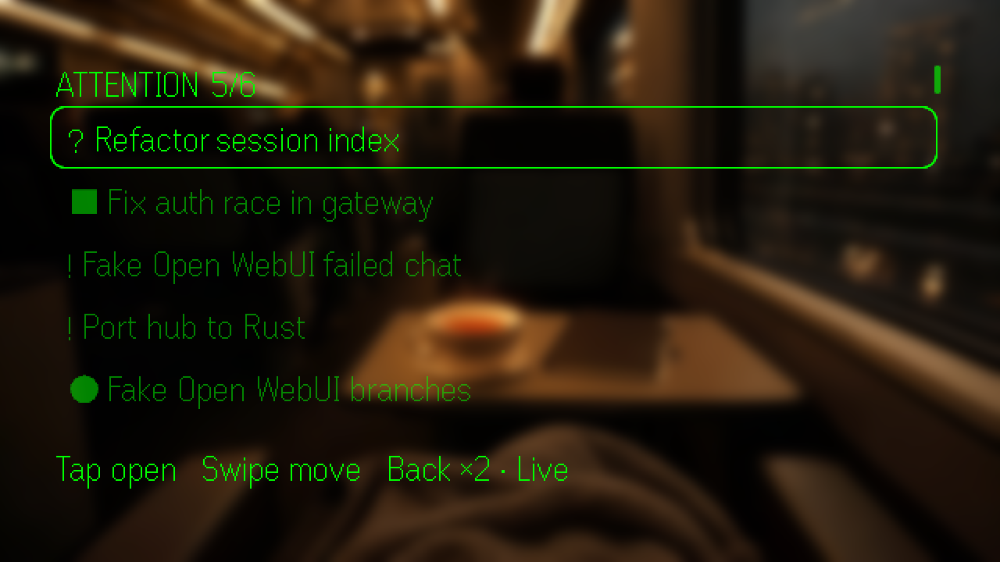
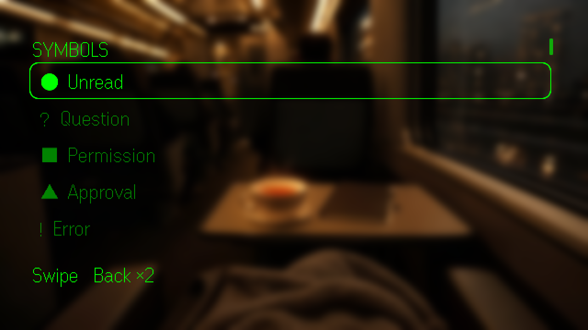

# Oktoso G2

The Even G2 client for Oktoso: a glanceable attention and reply surface for the
sessions your agents are running.

The hub owns provider credentials, indexing, attention, and event fan-out. The G2
app is a thin client served by the hub at `/apps/even-g2/`; it never talks to a
provider directly.

**Inbox**



**Answer**


**Symbols**



Screenshot capture and framing are documented in
[`docs/screenshot-procedure.md`](docs/screenshot-procedure.md).

## Phone bridge

The webview at `/apps/even-g2/` is the phone companion, not the glasses
framebuffer. The bridge paints the G2 containers; this page handles setup,
longer replies, and phone-side question forms.

- One header status (`Connected`, `Not connected`, or an error) and one product
  title. The app version is a quiet pill beside it.
- Unpaired: a single **Connect this phone** card. The pairing link or code is
  the primary path; a hub token is a disclosure underneath.
- Connected: the pairing form collapses to a compact `Connected · <host>` row
  with **Pair another**. The phone keyboard becomes the main fallback.
- The phone keyboard is disabled with `Open a session on the glasses first`
  when no session is attached. It does not leave an empty enabled composer,
  and it is named for screen readers.
- A **Glasses control** panel below the phone keyboard shows a fixed 2:1
  mirror of the 576×288 screen, with its list and current selection. Tap a row
  to open it; swipe up or down; double-tap to go back. Up / Down / Select / Back
  remain for precision. Using Up/Down on the phone or glasses switches the
  glasses list to a text mirror with a `›` marker; **Use glasses list** returns
  to the native list, because the SDK's native list selection is host-owned.
  The mirror window stays fixed while the marker moves; it shifts one row only
  when the marker crosses the top or bottom edge.
  Expand opens the same panel full-screen; Close or Escape returns. The preview
  keeps the app's 54-column wrapped lines and clips instead of reflowing, so
  content changes never resize it. Actions pulse the phone where supported. The
  four controls are 44px targets.
- The symbol guide stays user-facing. Bridge diagnostics and the reply audit
  live under a collapsed **Developer tools** disclosure. Every disclosure row
  is a 44px target.
- The bridge keeps browser zoom and uses control borders at 3:1 and text at
  4.5:1 or better against the dark surface.

## What it does

- **Pairing** — scan the hub's pairing QR, paste its link or code, or use a hub
  token. The phone surface exchanges the code for a session token.
- **Attention inbox** — provider permissions and forms, errors, unread root
  sessions, and automation approvals. Approvals reuse the same blocking row and
  detail screen with Approve / Deny; approval decisions call
  `/api/v1/automation/approvals`. Child sessions do not add unread noise. Error
  rows name the provider (`! desktop-opencode · …`) so a failure is
  attributable. All blocking items are shown; the Inbox adds a `More` row when
  the list is capped.
  A blocking item that arrives while Home is open opens the Inbox by itself.
  With nothing active the screen is a single top-aligned line — the glyph and
  title of the session you were last in — and one tap resumes it. With no
  session at all it reads `No session open.`
- **Provider state** — `provider.status` events mark the chat footer
  `Provider offline` or `Provider sign-in needed`; tapping opens the standard
  failure screen with `Retry`.
- **Failed turns** — when the last assistant message carries a provider error,
  the chat footer says `Tap for error`; the screen shows the provider's own
  message with `Retry` / `Back`.
- **Launch routing** — opening from the glasses menu lands on Inbox; opening
  from the phone app resumes the current chat; a reload stays on Home.
- **Device state** — the host reports wearing, charging, and battery. When the
  glasses are in the case or off the face, polling pauses (the event stream
  keeps data fresh); painting never does, so a reload or a wake is never
  swallowed by a wear-sensor reading. Battery and charging show in Settings.
- **Answer row grammar** — numbered rows (`1 Yes`) are answers; `›` rows
  open a page or an action (`› Type answer`, `› Speak answer`). The host
  renders every row with the same chrome, so the prefix is the whole
  distinction. Options are numbers; actions are chevrons.
- **Single choice review** — choosing a numbered answer opens `REVIEW`, never
  sends it. `› Send` is the only send gesture; `› Read full text…` opens the
  full answer read-only; `Back` returns. Every single answer therefore takes
  two taps, like a batch.
- **Chat** — six-line viewport, compact prioritized footer with line/message
  position, agent activity, stream state, and `? Answer` / `Tap reply`; SSE
  updates, read markers, and incremental message streaming. The pending
  question is re-read when a `question` tool call appears or the turn stops, so
  the footer cannot keep saying `Tap reply` after the agent asked something.
- **Replies** — canned and model-assisted reply options, numbered choices, voice,
  and a phone keyboard for longer text. The hub classifies the moment first: it
  skips the model while the agent is running with no ask, or after a finished
  turn with no ask or action, and the glass opens `SESSION` with `Stop` / `Phone
  keyboard`. When it does generate, it returns an answer, an opposite labelled
  `Alt:`, and an ask labelled `Ask:`, grounded in a compact MOMENT block with
  pending, done, and constraint state.
- **Contextual menu** — tap then long press on the chat: `Stop agent` and
  `Scroll to the bottom`, always in that order. Stop opens a confirmation screen
  and is idempotent: the provider answers `{"interrupted":false}` when nothing
  is running, so the menu never depends on guessing the turn state. Reply and
  voice keep their own first-class entry points, so the menu does not repeat
  them.
- **Questions** — yes/no, explicit choices, free-form answers, destructive
  confirmation, stale-question protection, and idempotent retries on every
  send. A provider choice that only means "Other" becomes `Type your own
  answer`, so the sentinel itself is never sent. The answer screen also offers
  `Speak answer` when transcription is configured, 2–3 `Suggested answers`
  from the local reply model, `Read chat`, and a confirmed `Stop agent`.
  Provider-native `question` tool calls use the same chat answer flow as
  text questions; the Inbox form remains the formal alternative.
- **Batch answers** — a multi-question turn opens `ANSWER` with `› Answer N
  questions` and `› Answer N questions on phone`. The glass path answers one
  question per screen (`ANSWER · Q1/N`), then `REVIEW · N answers`, and `Send
  all` sends the same one numbered message with per-question metadata. Each
  question keeps `Type answer` / `Speak answer` / `Answer on phone` / `Back`;
  the phone form stays the fallback and shares the same entries.
- **Question discovery** — Home, Recent, and Inbox mark pending questions before
  the chat is opened, including provider-native questions.
- **Current session** — the last opened session is stored locally and restored
  as the Home `Current` row after a reload.
- **Failure states** — auth expired, hub offline, agent offline, timeout, rate
  limit, not found, and server errors have distinct retry or pairing actions.
- **Unsent sends** — a send that times out or fails stays in a local queue and
  appears as `Unsent` on Home. Retry reuses the original idempotency key;
  discard removes it.
- **Symbols** — compact single-cell glyphs replace status words. A persistent
  legend lives on Home → Symbols and on the phone.
- **Settings** — action list with `Refresh data` and `Reload app` (reload happens
  immediately), plus connection, version, last refresh, and glasses battery in
  the body.
  App version appears beside the `OKTOSO` header. A successful phone pairing
  collapses the pairing form to a compact connected row.

Voice replies use the glasses microphone (16 kHz, signed 16-bit little-endian,
mono) and the hub's configured transcription endpoint. The voice action is
hidden when transcription is disabled or missing a base URL or model. The phone
remains the keyboard for long or free-form answers.

**Voice reply is the first row of the first reply page**, and it is offered
while the suggestions are still loading. Opening the reply screen and tapping
once starts the recording; no paging or scrolling is involved. Later pages show
their full set of suggestions without repeating the shortcut. On the answer
screen voice sits after the choices, because a stray first tap must never open
the microphone; a free-form question has no choice under the first tap, so it
may lead with `Speak answer`. Back and Cancel return to the screen that opened
the microphone.

The voice screen owns the whole exchange. It paints first and opens the
microphone second, because rebuilding the page container after `audioControl`
can drop the host capture session. It then reports the outcome on the glasses:
the transcript with **Send** / **Edit on phone**, or the failure as a plain
sentence. Sizes, frame counts, and timings go to the phone log, not the glass.
A microphone that never delivered
a frame therefore says so on the glasses instead of silently returning to the
chat. One tap on the result sends the reply; Back leaves. For a batch question
the result offers `Send` / `Back` and saves the transcript as that question's
answer, then advances to the next question; it never sends a chat reply. Taps that opened or
closed the previous screen are ignored for a moment so a single gesture never
acts twice. After a send the glasses return to the chat, and the view follows
the message in as soon as the provider echoes it, even when the echo lands a
few seconds after the send.

## Screen map

```text
Home
├─ Inbox            attention items
├─ Unsent           failed sends, when present
├─ Retry / Pair     inline failure, when present
├─ Recent           root sessions, five per page, More loads older
├─ Current          last opened session, when available
├─ Symbols          glyph legend
└─ Settings         data refresh, reload, connection, version

Inbox
├─ Empty            the session to resume, tap to open
├─ Attention        permission / form / error / unread / automation detail
└─ More             additional items beyond the glass cap

Chat
├─ Answer           choices / Type your own answer / Speak answer /
│                   Suggested answers / Failure
├─ Batch            one question at a time, then review, or the phone form
├─ Review           numbered answers, tap to edit, Send all
├─ Suggested        model answers for the open question, tap to send
├─ Type             phone keyboard handoff
├─ Reply            answer / opposite (`Alt`) / ask, plus canned
├─ Voice            listen / transcribe / Send or Edit on phone, hidden without hub STT
├─ Stop agent       confirmation, from the chat menu
├─ Turn failed      provider error + Retry / Back
└─ Phone keyboard   longer text fallback

Failure
└─ Auth / offline / provider / timeout   Retry or Pair this phone, Back
```

Back always follows where you came from; on Recent it first steps one page
back. A failed background refresh stays inline as a `Retry · <state>` row
instead of taking over the screen.

## UX rules

- One primary action per screen; secondary actions stay quiet.
- The glass speaks in sentences. Sizes, frame counts, and timings belong in the
  phone log.
- Voice reply is the first row of the first reply page. On the answer screen it
  follows the choices, never leads them.
- Lists scroll with the platform gesture. Recent pages five at a time, and Back
  steps one page back before it leaves.
- The contextual menu holds a shortcut that has no other control, not a second
  copy of the screen's actions.
- An action the user started never fails silently: it ends on a screen with
  `Retry`/`Back`, or on the chat with `Tap retry` in the footer.
- A new screen has to replace a step, not add one: Settings reloads in one tap,
  and an empty Inbox is one line.
- The landing screen comes from the launch source, not from a menu the user has
  to learn.
- The glass keeps painting; only polling pauses in the case or off the face.
  A stale wear reading must never blank a reload.
- Live updates are batched: at most one state rebuild and glass paint per
  600 ms, with a trailing flush, so a streaming turn costs a fraction of the
  BLE writes without reading as laggy. Only the container that changed is
  written (live text changes the body, not the footer). Refresh work is keyed,
  so a burst of events coalesces to one inbox/chat refresh instead of one per
  event.
- Polling is a fallback, not a rhythm: it runs only while the event stream is
  down, starting at 4 s and backing off to 30 s while it stays down; asleep
  glasses poll at 30 s.
- The stream resumes from the last seen event sequence, so reopening the app
  does not replay the hub's whole buffer. It also asks for a 60 s keepalive
  instead of the browser's 15 s, which cuts idle radio wakeups by four.

## Regression harness

`tests/e2e/g2.e2e.ts` drives the hosted app through the same channel the Even
host uses: `rebuildPageContainer` for pages and menus, `evenHubEvent` for taps,
menu selections, and audio frames. It runs against a test hub with fake
providers, so no real session or provider is touched.

```sh
pnpm build:single-port
pnpm test:e2e:g2
```

It covers boot and navigation, the empty Inbox one-liner, the always-on `Stop
agent` menu declaration, stop → confirm → chat, and the voice listen →
transcribe → result → send flow. It runs with the rest of the e2e suite
(`pnpm test:e2e`) in CI.

Limits: it does not render the OS menu overlay, capture a real microphone, or
paint the framebuffer. Use the Even simulator or hardware for those; this
harness is for screen transitions and host-contract regressions.

## Symbols

The simulator verified these glyphs. They are single-cell characters, not emoji.

| Glyph | Meaning |
|---|---|
| `●` | Unread |
| `?` | Question |
| `■` | Permission |
| `▲` | Approval |
| `!` | Error |
| `▶` | Running |
| `▼` | Offline |
| `◇` | Idle |
| `◆` | Generic attention |
| `›` | Subagent prefix |
| `›?` | Child question |
| `›■` | Child permission |

`⚿`, `✓`, `↳`, `✕`, `✖`, and `✔` are not rendered by the G2 font and must not
be used.

The glass legend is read-only: swipe to scroll, double-tap Back to leave. The phone
surface has a collapsible **Symbol guide** with the same list.

## Pairing

From the hub terminal, press `p` and Enter to create a pairing code.

On the phone surface:

1. Scan the terminal QR, or paste the pairing link/code.
2. Press **Pair this phone**.
3. The app exchanges the code for a session token and stores it locally.

The app requests the `g2` profile when it exchanges the code, so you pair
normally: press `p` in the hub terminal or run `oktoso pair`, then use the
link. The resulting session is restricted to sessions, inbox, approvals,
read-only providers/settings, voice, and events. It cannot edit providers,
settings, or admin credentials. Re-pair an existing G2 once to replace a
legacy phone-profile session.

A browser paired through `/pair/<code>` uses the HttpOnly session cookie instead
and keeps the `phone` profile. A token can be pasted as a fallback when the app
is loaded from another origin. The owner token is never included in the G2
package.

## Input grammar

| Input | Action |
|---|---|
| Ring tap / R1 tap | Open, select, reply, or run a session action |
| Double tap | Back |
| Scroll / swipe | Move selection or chat line |
| Tap then long press | `Stop agent` (with confirmation) and `Scroll to the bottom` |

The OS owns the tap-then-long-press gesture for its menu, so plain long press
only reaches the app when the OS does not claim it. The menu is declared with
each page (`menuObject`) and must be carried forward on every rebuild. It stays
one shortcut, not a second navigation tree: reply and voice are already on the
surface they belong to.

## Run locally

```sh
pnpm install
pnpm dev            # hub + web on 5175
pnpm dev:even-g2    # G2 app on 5176
pnpm simulate:even-g2
```

The dev G2 app proxies `/api` to the hub. The simulator can also load the hosted
build from the hub:

```sh
pnpm build:single-port
pnpm start:local
```

Then open:

```text
http://<hub-host>:8787/apps/even-g2/
```

## Build and package

```sh
pnpm --filter @amoshydra/oktoso-even-g2 build
```

For the hosted app served by the hub:

```sh
pnpm build:even-g2:hosted
```

For an Even Hub package, provide the hub origin so the generated manifest
whitelist matches the deployment:

```sh
VITE_HUB_URL=https://hub.example.com \
  pnpm --filter @amoshydra/oktoso-even-g2 build
HUB_ORIGIN=https://hub.example.com pnpm pack:even-g2
```

`HUB_ORIGIN` must include the scheme and any non-default port. The pack script
writes a temporary `.app.pack.json`, packs `dist`, and removes the temporary
manifest.

Release-please bumps `app.json` and `package.json` through the root
`release-please-config.json` extra files, so the Even Hub listing stays in sync
with the npm release.

## Subagents and attention

Sessions with `parentRef` are child sessions.

- Child sessions do not create `UNREAD` or `ERROR` attention items.
- Recent requests `scope=root`, so child sessions do not appear there.
- Recent loads 25 root sessions, shows five per page, and follows the hub's
  cursor for older pages. `More sessions →` is the last row; Back steps one
  page back before it leaves the screen.
- Child provider-native permissions and questions remain visible with a `›`
  prefix because they can block the parent task.
- A blocking permission/question suppresses a duplicate unread row for the same
  session.

OpenCode is the provider that currently exposes `parentID`. A child permission
prompt is not reliably propagated to the parent UI, and a dropped prompt can
leave the parent turn busy. The hub's global permission/form poll is the fallback.
If OpenCode drops the request before the hub sees it, there is no hub-side
recovery path. Plain-text child questions are task output, not blocking forms, so
they are not surfaced as separate question markers.

Open WebUI exposes no parent/session hierarchy in the current adapter; its
sessions are treated as primary.

## Reply audit

The G2 phone surface links to a reply audit page at:

```text
http://<hub-host>:8787/apps/even-g2/audit.html
```

It shows the exact system prompt, context, raw model output, and generated
options for one session. Rate each option and save the feedback; entries are
appended to `<dataDir>/reply-feedback.jsonl` and can be exported as JSONL for
prompt and context analysis. See [`../../docs/reply-audit.md`](../../docs/reply-audit.md).

## Hardware validation

```sh
pnpm build:single-port
pnpm hardware:check
```

The preflight checks the manifest version, network whitelist, and built assets.
Run the scripted acceptance checklist in
[`../../docs/g2-hardware-validation.md`](../../docs/g2-hardware-validation.md) on
real glasses. The simulator and phone preview drive the same handlers, but real
input timing, scroll feel, reconnect behavior, and long-session reading position
still require hardware.

## Security

- Provider credentials stay on the hub.
- The G2 app stores a session token, never the owner token.
- Pairing codes are single-use and expire after five minutes.
- The hosted app and API share an origin, so a paired browser uses the HttpOnly
  cookie.
- The packaged app only allows the configured hub origin in its network
  whitelist.

## Related docs

- [`../../docs/glass-ux.md`](../../docs/glass-ux.md) — screen map, input grammar,
  glyphs, reliability, and attention policy
- [`../../docs/g2-question-flow.md`](../../docs/g2-question-flow.md) — full
  question-flow design and answer model
- [`../../docs/reply-audit.md`](../../docs/reply-audit.md) — reply model audit and
  feedback loop
- [`../../docs/wearables.md`](../../docs/wearables.md) — Even Hub setup, packaging,
  and device limits
- [`../../docs/g2-hardware-validation.md`](../../docs/g2-hardware-validation.md) —
  scripted hardware acceptance run
- [`docs/screenshot-procedure.md`](docs/screenshot-procedure.md) — capture,
  background generation, and opaque framing procedure
- [`../../docs/design.md`](../../docs/design.md) — hub architecture and provider
  model
