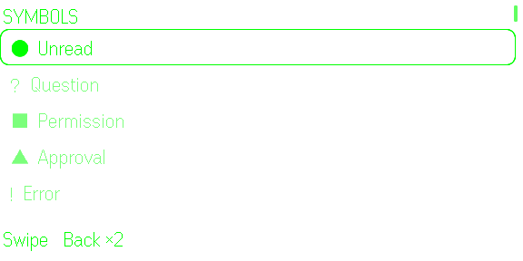

# Oktoso G2

The Even G2 client for Oktoso: a glanceable attention and reply surface for the
sessions your agents are running.

The hub owns provider credentials, indexing, attention, and event fan-out. The G2
app is a thin client served by the hub at `/apps/even-g2/`; it never talks to a
provider directly.

> The screenshots below come from the repository's fake provider fixture. No real
> account, session, or provider data is shown.

<p align="center">
  
</p>

| Answer a question | Symbol legend |
|---|---|
|  |  |

## What it does

- **Pairing** — scan the hub's pairing QR, paste its link or code, or use a hub
  token. The phone surface exchanges the code for a session token.
- **Attention inbox** — provider permissions and forms, errors, and unread root
  sessions. Child sessions do not add unread noise.
- **Chat** — six-line viewport, line/message position, agent activity, SSE updates,
  read markers, and incremental message streaming.
- **Replies** — canned and model-assisted reply options, numbered choices, and a
  phone keyboard for longer text.
- **Questions** — yes/no, explicit choices, free-form answers, destructive
  confirmation, stale-question protection, and idempotent retries.
- **Batch answers** — every question in a multi-question turn is shown on the
  phone and sent as one numbered message.
- **Question discovery** — Home, Recent, and Inbox mark pending questions before
  the chat is opened.
- **Failure states** — auth expired, hub offline, agent offline, timeout, rate
  limit, not found, and server errors have distinct retry or pairing actions.
- **Symbols** — compact single-cell glyphs replace status words. A persistent
  legend lives on Home → Symbols and on the phone.

Voice capture/STT is not implemented. The phone remains the keyboard for long or
free-form answers.

## Screen map

```text
Home
├─ Inbox            attention items
├─ Recent           five most recent root sessions
├─ Current          last opened session, when available
└─ Symbols          glyph legend

Inbox
└─ Attention        permission / form / error / unread detail

Chat
├─ Answer           choices + Type answer / More / Read chat
├─ Batch            Answer on phone / More / Read chat
├─ More             More replies / Read chat / Stop
├─ Type             phone keyboard handoff
├─ Reply            canned, model-assisted, and numbered choices
└─ Phone keyboard   longer text fallback

Failure
└─ Auth / offline / provider / timeout   Retry or Pair this phone, Back
```

Back always follows where you came from. A failed background refresh stays inline
as a `Retry · <state>` row instead of taking over the screen.

## Symbols

The simulator verified these glyphs. They are single-cell characters, not emoji.

| Glyph | Meaning |
|---|---|
| `●` | Unread |
| `?` | Question |
| `■` | Permission |
| `▲` | Approval |
| `!` | Error |
| `▶` | Running |
| `▼` | Offline |
| `◇` | Idle |
| `◆` | Generic attention |
| `›` | Subagent prefix |
| `›?` | Child question |
| `›■` | Child permission |

`⚿`, `✓`, `↳`, `✕`, `✖`, and `✔` are not rendered by the G2 font and must not
be used.

The glass legend is read-only: swipe to scroll, double-tap Back to leave. The phone
surface has a collapsible **Symbol guide** with the same list.

## Pairing

From the hub terminal, press `p` and Enter to create a pairing code.

On the phone surface:

1. Scan the terminal QR, or paste the pairing link/code.
2. Press **Pair this phone**.
3. The app exchanges the code for a session token and stores it locally.

A browser paired through `/pair/<code>` uses the HttpOnly session cookie instead.
A token can be pasted as a fallback when the app is loaded from another origin.
The owner token is never included in the G2 package.

## Input grammar

| Input | Action |
|---|---|
| Ring tap / R1 tap | Open, select, or reply |
| Double tap | Back |
| Scroll / swipe | Move selection or chat line |

There is no long-press event in the SDK. Do not hide required actions behind
gestures the SDK does not expose.

## Run locally

```sh
pnpm install
pnpm dev            # hub + web on 5175
pnpm dev:even-g2    # G2 app on 5176
pnpm simulate:even-g2
```

The dev G2 app proxies `/api` to the hub. The simulator can also load the hosted
build from the hub:

```sh
pnpm build:single-port
pnpm start:local
```

Then open:

```text
http://<hub-host>:8787/apps/even-g2/
```

## Build and package

```sh
pnpm --filter @amoshydra/oktoso-even-g2 build
```

For the hosted app served by the hub:

```sh
pnpm build:even-g2:hosted
```

For an Even Hub package, provide the hub origin so the generated manifest
whitelist matches the deployment:

```sh
VITE_HUB_URL=https://hub.example.com \
  pnpm --filter @amoshydra/oktoso-even-g2 build
HUB_ORIGIN=https://hub.example.com pnpm pack:even-g2
```

`HUB_ORIGIN` must include the scheme and any non-default port. The pack script
writes a temporary `.app.pack.json`, packs `dist`, and removes the temporary
manifest.

Release-please bumps `app.json` and `package.json` through the root
`release-please-config.json` extra files, so the Even Hub listing stays in sync
with the npm release.

## Subagents and attention

Sessions with `parentRef` are child sessions.

- Child sessions do not create `UNREAD` or `ERROR` attention items.
- Recent requests `scope=root`, so child sessions do not appear there.
- Child provider-native permissions and questions remain visible with a `›`
  prefix because they can block the parent task.
- A blocking permission/question suppresses a duplicate unread row for the same
  session.

OpenCode is the provider that currently exposes `parentID`. A child permission
prompt is not reliably propagated to the parent UI, and a dropped prompt can
leave the parent turn busy. The hub's global permission/form poll is the fallback.
If OpenCode drops the request before the hub sees it, there is no hub-side
recovery path. Plain-text child questions are task output, not blocking forms, so
they are not surfaced as separate question markers.

Open WebUI exposes no parent/session hierarchy in the current adapter; its
sessions are treated as primary.

## Hardware validation

```sh
pnpm build:single-port
pnpm hardware:check
```

The preflight checks the manifest version, network whitelist, and built assets.
Run the scripted acceptance checklist in
[`../../docs/g2-hardware-validation.md`](../../docs/g2-hardware-validation.md) on
real glasses. The simulator and phone preview drive the same handlers, but real
input timing, scroll feel, reconnect behavior, and long-session reading position
still require hardware.

## Security

- Provider credentials stay on the hub.
- The G2 app stores a session token, never the owner token.
- Pairing codes are single-use and expire after five minutes.
- The hosted app and API share an origin, so a paired browser uses the HttpOnly
  cookie.
- The packaged app only allows the configured hub origin in its network
  whitelist.

## Related docs

- [`../../docs/glass-ux.md`](../../docs/glass-ux.md) — screen map, input grammar,
  glyphs, reliability, and attention policy
- [`../../docs/g2-question-flow.md`](../../docs/g2-question-flow.md) — full
  question-flow design and answer model
- [`../../docs/wearables.md`](../../docs/wearables.md) — Even Hub setup, packaging,
  and device limits
- [`../../docs/g2-hardware-validation.md`](../../docs/g2-hardware-validation.md) —
  scripted hardware acceptance run
- [`../../docs/design.md`](../../docs/design.md) — hub architecture and provider
  model
